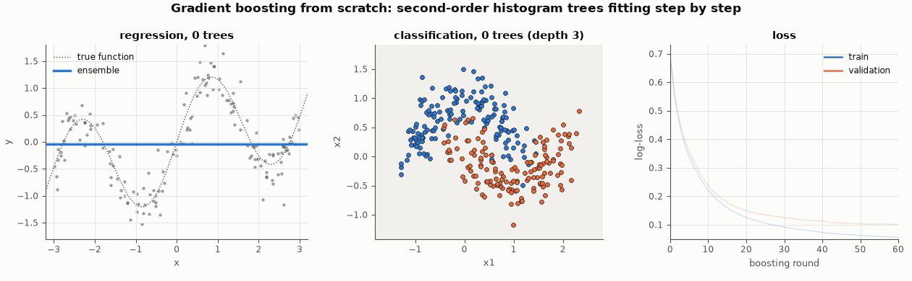
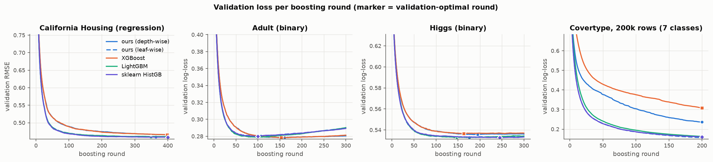
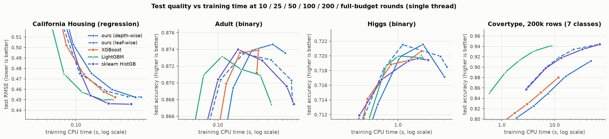
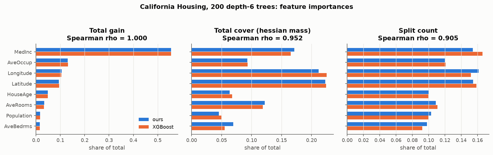
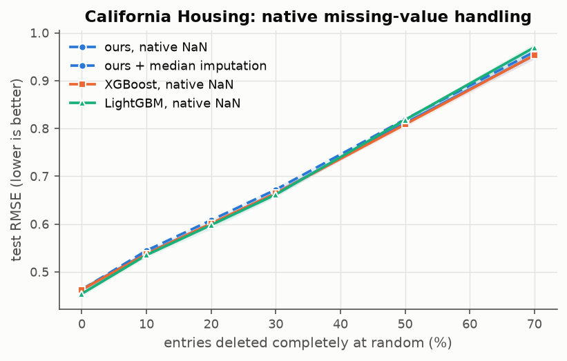
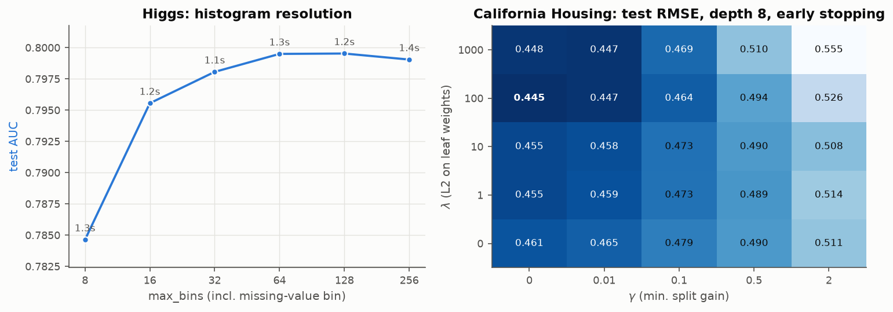
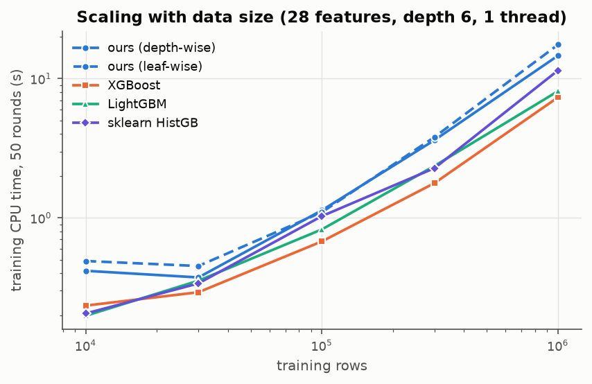

# gradient-boosting-from-scratch

[](https://github.com/Jai-Advitheeya-Lella/gradient-boosting-from-scratch/actions/workflows/tests.yml)

XGBoost-style gradient-boosted decision trees in NumPy and Numba: second-order split gain, histogram split finding, missing-value default directions, pluggable losses, benchmarked against XGBoost, LightGBM and scikit-learn.



This is a from-scratch reimplementation for learning and research. The boosting loop, tree grower, histogram and split-search kernels, losses and early stopping are written here; XGBoost, LightGBM and scikit-learn appear only as baselines and as references in the tests.

## Highlights

- **Second-order boosting.** Each round fits a tree to the gradient $g_i$ and hessian $h_i$ of the loss, with leaf weights $w^\ast=-T_\alpha(G)/(H+\lambda)$ and split gain $\tfrac12[S_L+S_R-S_{L+R}]-\gamma$ (L1 and L2 regularisation, $\gamma$ complexity penalty).
- **Histogram split finding** on at most 255 quantile bins per feature, with the histogram-subtraction trick, ordered gradients and a Numba kernel that is parallel over features.
- **Sparsity-aware missing values.** Both default directions are evaluated at every split and the better one is stored in the node; a reserved bin holds NaNs.
- **Both growth policies**: depth-wise (XGBoost) and leaf-wise / loss-guided (LightGBM, scikit-learn).
- **Shrinkage, row subsampling, GOSS, column sampling per tree and per node, early stopping** with best-iteration prediction, sample weights.
- **Losses**: squared error, pseudo-Huber, logistic, softmax multiclass, and a custom-loss API that only needs `(grad, hess)`.
- **Verified against the references.** On data whose features are exactly binnable the trees are identical to XGBoost's (predictions within 2e-5, including $\gamma$, L1, and missing values) and to scikit-learn's HistGradientBoosting (within 1e-7, leaf-wise and multiclass softmax). 47 tests, which also check losses by finite differences and the split search against brute force.
- **Benchmarked on four real datasets.** The depth-wise model reaches the same test metrics as XGBoost within split noise (Adult accuracy 0.8727 vs 0.8721, California RMSE 0.4599 vs 0.4612). It is 1.7x to 4x slower than XGBoost on one thread (details and caveats below).

## Results

Hardware: a shared 24-core Linux machine, CPU only (no GPU is involved). Because other jobs were running on the machine, every benchmark uses **one thread** and reports **CPU time** (`time.process_time`), which is stable under contention; wall-clock multi-thread timings on that machine were not. Timings below are the best over the runs shown. Every library uses the same budget and matched hyper-parameters: learning rate 0.1, $\lambda=1$, `min_child_weight` 1, at most $2^{\text{depth}}$ leaves, at most 255 bins, no subsampling, no early stopping (fixed number of rounds so that times are comparable). Binning is included in the training time. Accuracy and loss are on a held-out test split (60/20/20 train/validation/test; validation is used for the early-stopping-style table only), mean ± std over split seeds.

"ours (depth-wise)" is directly comparable with XGBoost; "ours (leaf-wise)" with LightGBM and scikit-learn.

**California Housing** (regression; 12,384 train rows, 8 features; depth 6, 400 rounds; 3 split seeds)

| Library | RMSE | MAE | R² | Train CPU time (s) |
|---|---|---|---|---|
| ours (depth-wise) | 0.4599 ± 0.0061 | 0.3007 ± 0.0017 | 0.8398 ± 0.0023 | 0.62 |
| ours (leaf-wise) | 0.4588 ± 0.0070 | 0.3003 ± 0.0026 | 0.8407 ± 0.0026 | 0.65 |
| XGBoost | 0.4612 ± 0.0069 | 0.3010 ± 0.0018 | 0.8389 ± 0.0029 | 0.33 |
| LightGBM | 0.4556 ± 0.0052 | 0.2985 ± 0.0015 | 0.8428 ± 0.0014 | 0.29 |
| sklearn HistGB | 0.4554 ± 0.0106 | 0.2981 ± 0.0053 | 0.8430 ± 0.0051 | 0.48 |

**Adult** (binary; 29,304 train rows, 14 features, 1% missing; depth 6, 300 rounds; 3 split seeds)

| Library | Accuracy | AUC | Log-loss | Train CPU time (s) |
|---|---|---|---|---|
| ours (depth-wise) | 0.8727 ± 0.0009 | 0.9287 ± 0.0020 | 0.2767 ± 0.0032 | 0.62 |
| ours (leaf-wise) | 0.8682 ± 0.0008 | 0.9246 ± 0.0017 | 0.2873 ± 0.0032 | 0.80 |
| XGBoost | 0.8721 ± 0.0008 | 0.9286 ± 0.0020 | 0.2769 ± 0.0032 | 0.30 |
| LightGBM | 0.8698 ± 0.0017 | 0.9253 ± 0.0016 | 0.2860 ± 0.0035 | 0.44 |
| sklearn HistGB | 0.8691 ± 0.0017 | 0.9250 ± 0.0018 | 0.2862 ± 0.0038 | 0.79 |

**Higgs** (binary; 58,830 train rows, 28 features; depth 6, 300 rounds; 3 split seeds)

| Library | Accuracy | AUC | Log-loss | Train CPU time (s) |
|---|---|---|---|---|
| ours (depth-wise) | 0.7226 ± 0.0039 | 0.8021 ± 0.0033 | 0.5364 ± 0.0037 | 3.06 |
| ours (leaf-wise) | 0.7225 ± 0.0028 | 0.8016 ± 0.0032 | 0.5371 ± 0.0038 | 2.73 |
| XGBoost | 0.7255 ± 0.0042 | 0.8028 ± 0.0042 | 0.5358 ± 0.0047 | 1.77 |
| LightGBM | 0.7244 ± 0.0035 | 0.8019 ± 0.0041 | 0.5369 ± 0.0049 | 1.76 |
| sklearn HistGB | 0.7254 ± 0.0052 | 0.8023 ± 0.0039 | 0.5364 ± 0.0043 | 2.07 |

**Covertype** (7 classes; stratified 200k-row subset of the 581k-row dataset, 120,000 train rows, 54 features; depth 8, 200 rounds; 2 split seeds)

| Library | Accuracy | Log-loss | Train CPU time (s) |
|---|---|---|---|
| ours (depth-wise) | 0.9128 ± 0.0010 | 0.2332 ± 0.0000 | 46.74 |
| ours (leaf-wise) | 0.9434 ± 0.0000 | 0.1577 ± 0.0016 | 53.79 |
| XGBoost | 0.8804 ± 0.0005 | 0.3084 ± 0.0018 | 11.72 |
| LightGBM | 0.9423 ± 0.0006 | 0.1625 ± 0.0005 | 8.24 |
| sklearn HistGB | 0.9446 ± 0.0006 | 0.1593 ± 0.0003 | 57.27 |

What the tables say:

- **Quality matches the references.** Within each growth-policy family the models are within about one standard deviation of each other on every dataset: the depth-wise model tracks XGBoost almost exactly (it is the same algorithm), and the leaf-wise model tracks LightGBM and scikit-learn. The two families differ from each other on Adult (depth-wise is about 0.4 accuracy points better with these settings) and on Covertype, where 256 leaves reach a given loss far faster than depth 8 (and XGBoost's convention penalises it further, see below). The remaining differences inside a family (for instance California RMSE 0.4554 for scikit-learn against 0.4588 for our leaf-wise model) are smaller than the split-to-split spread; on quantised data with exact bins our trees coincide with the references' (see the tests).
- **Speed: slower, same order of magnitude.** On one thread our implementation needs 1.7x to 2.1x the CPU time of XGBoost on the three smaller datasets, and 4x on Covertype depth-wise. Leaf-wise, it is on par with scikit-learn on Covertype (53.8 s vs 57.3 s) and 6.5x slower than LightGBM (8.2 s), which is the fastest there. Covertype has 44 sparse one-hot columns; LightGBM bundles mutually exclusive features, which this implementation does not do, and that is the likely reason. At 1M rows of dense synthetic data (50 rounds, 28 features) the CPU times are 14.6 s (ours), 7.4 s (XGBoost), 8.1 s (LightGBM) and 11.5 s (scikit-learn).
- **XGBoost's Covertype accuracy (0.880) is lower at a fixed 200-round budget because of its softmax hessian.** XGBoost uses $2p(1-p)$ where this implementation and scikit-learn use the exact diagonal $p(1-p)$, which halves every Newton step at equal learning rate. Doubling XGBoost's learning rate to 0.2 gives accuracy 0.9138 and log-loss 0.2282 (split seed 0, `scripts/covertype_xgb_check.py`), against 0.9119 and 0.2332 for our depth-wise model. This is a convention difference, not a quality difference.
- **The numbers use a fixed number of rounds, not tuned ones.** On Adult the validation loss is minimal after about 100 to 160 rounds and the 300-round models overfit slightly, which is why test accuracy peaks and then falls in the second figure below. Nothing was tuned per library.





**Test quality at the validation-optimal round** (split seed 0; the model is truncated at the round with the lowest validation loss, as early stopping would do):

| Dataset | Metric | ours (depth-wise) | ours (leaf-wise) | XGBoost | LightGBM | sklearn HistGB |
|---|---|---|---|---|---|---|
| California | RMSE | 0.4524 (r 400) | 0.4517 (r 364) | 0.4525 (r 398) | 0.4499 (r 349) | 0.4457 (r 400) |
| Adult | accuracy | 0.8741 (r 161) | 0.8721 (r 107) | 0.8740 (r 153) | 0.8717 (r 99) | 0.8727 (r 100) |
| Higgs | AUC | 0.7994 (r 195) | 0.7988 (r 176) | 0.7989 (r 163) | 0.7993 (r 147) | 0.7988 (r 245) |

(`r` is the selected round. The same table for all metrics is in `results/benchmark_tables.md`.)

### Feature importance

Importances are computed per tree and summed (`weight` = number of splits, `total_gain`, `total_cover` = hessian mass of the split nodes, same definitions as XGBoost). On California Housing, 200 depth-6 trees, they agree with XGBoost's: Spearman correlation 1.000 for total gain (largest difference in a feature's share 0.0012), 0.952 for total cover and 0.905 for split count.



### Missing values

Entries of the California Housing features (train, validation and test) were deleted completely at random. Learned default directions are compared with median imputation followed by our model (test RMSE, mean over 3 seeds, 300 depth-6 rounds):

| Entries deleted | 0% | 10% | 20% | 30% | 50% | 70% |
|---|---|---|---|---|---|---|
| ours, native NaN | 0.4630 | 0.5386 | 0.6003 | 0.6645 | 0.8112 | 0.9531 |
| ours + median imputation | 0.4630 | 0.5446 | 0.6081 | 0.6720 | 0.8191 | 0.9602 |
| XGBoost, native NaN | 0.4628 | 0.5375 | 0.6012 | 0.6645 | 0.8084 | 0.9533 |
| LightGBM, native NaN | 0.4542 | 0.5352 | 0.5981 | 0.6618 | 0.8180 | 0.9697 |

Learned default directions beat imputing the median by 0.7% to 1.3% RMSE at every nonzero missing rate and match XGBoost's. The gap is small: with random deletion the missingness carries no information, so the benefit comes from routing rather than from informative missingness.



### Ablations



- **Bins** (Higgs, 150 depth-6 rounds): test AUC is 0.7846 with 8 bins, 0.7956 with 16, 0.7981 with 32 and 0.7995 with 64 or 128; 256 gives 0.7990. Quantile bins lose little above 64. Training time barely changes with the bin count here (1.1 s to 1.4 s).
- **$\lambda$ and $\gamma$** (California Housing, depth 8, early stopping on validation, test RMSE): the best cell is $\lambda=100$, $\gamma=0$ with 0.4452, against 0.4554 for the default $\lambda=1$. For squared error the split gain scales with node size and shrinking residuals, so even a small $\gamma$ stops growth early and only hurts in this grid.
- **Sampling** (Higgs, 150 depth-6 rounds; mean ± std of 3 sampler seeds, test AUC / CPU time of the best run):

| Scheme | AUC | CPU time (s) |
|---|---|---|
| full data | 0.7990 | 1.45 |
| uniform 50% rows | 0.7969 ± 0.0008 | 1.40 |
| uniform 30% rows | 0.7927 ± 0.0020 | 1.15 |
| GOSS (top 20% + 10% of the rest) | 0.7888 ± 0.0002 | 1.08 |
| 50% columns per tree | 0.7995 ± 0.0003 | 1.07 |
| 50% columns per node | 0.7992 ± 0.0005 | 1.38 |

Row subsampling costs AUC at this fixed round budget and saves at most about a quarter of the time; column sampling per tree costs nothing here.

### Scaling and a custom loss



Custom losses only need gradient and hessian. `examples/custom_loss.py` trains on data where 10% of the training targets carry gross outliers and scores against the noiseless signal (RMSE / MAE, lower is better):

| Loss | RMSE | MAE |
|---|---|---|
| squared error | 1.3887 | 0.9804 |
| pseudo-Huber (built in, $\delta=1$) | 0.9939 | 0.7348 |
| log-cosh (`CustomLoss`, 4 lines) | 0.7777 | 0.5352 |

## How it works

**Objective.** At round $m$ the booster takes a second-order Taylor expansion of the loss around the current margins $F_{m-1}(x_i)$, with per-sample gradient $g_i=\partial_F \ell$ and hessian $h_i=\partial_F^2 \ell$. For a tree with leaves $j=1..T$ and leaf weights $w_j$ the regularised objective is

$$\tilde{\mathcal L} = \sum_j \Big[ G_j w_j + \tfrac12 (H_j+\lambda) w_j^2 + \alpha |w_j| \Big] + \gamma T, \qquad G_j=\sum_{i\in I_j} g_i,\; H_j=\sum_{i\in I_j} h_i .$$

Minimising over $w_j$ gives the leaf weight and structure score (Chen & Guestrin, eqs. 5-6; the L1 term enters through the soft threshold $T_\alpha(G)=\operatorname{sign}(G)\max(|G|-\alpha,0)$):

$$w_j^\ast = -\frac{T_\alpha(G_j)}{H_j+\lambda}, \qquad S(G,H)=\frac{T_\alpha(G)^2}{H+\lambda}.$$

**Split gain.** Splitting a node into children $L$ and $R$ changes the objective by

$$\text{gain} = \tfrac12\big[ S(G_L,H_L) + S(G_R,H_R) - S(G_L+G_R,\,H_L+H_R) \big] - \gamma ,$$

and a split is taken only if the gain is positive, so $\gamma$ is a per-leaf complexity penalty. Leaf values are multiplied by the learning rate $\eta$ (shrinkage).

**Histograms on quantile bins.** Every feature is quantised once into at most 255 bins whose edges are quantiles of the training data (`BinMapper`); a 256th bin is reserved for missing values. Growing a node then means filling a `(features, bins, 3)` histogram of $\sum g$, $\sum h$ and counts with one pass over the node's rows (Numba kernel, parallel over features), and scanning prefix sums over the bins to evaluate every threshold. Only the smaller child of a split is histogrammed; its sibling is `parent - child` (the subtraction trick of LightGBM). Gradients are gathered into row order first so the inner loop reads memory sequentially.

**Missing values.** For every candidate threshold on a feature that has missing values in the node, both default directions are evaluated (sparsity-aware split finding, Algorithm 3 of the XGBoost paper) together with the split that isolates the missing values; the better direction is stored in the node and used at prediction time. If a feature had no missing values in training, unseen NaNs follow the larger child.

**Tree growth.** `grow_policy="depthwise"` expands nodes level by level up to `max_depth` (XGBoost); `"lossguide"` always expands the leaf with the largest gain up to `max_leaves` (LightGBM, scikit-learn). Both share one priority-queue implementation. Row subsampling (`subsample`), gradient-based one-side sampling (`sampling="goss"`, keep the largest-$|g|$ rows and re-weight a random sample of the rest by $(1-a)/b$) and column sampling per tree / per node are supported, as is early stopping on a validation set (prediction then uses the best round).

**Losses and the custom-loss API.** The booster only needs $g$ and $h$ with respect to the raw margin:

| Loss | $\ell(y,F)$ | $g$ | $h$ |
|---|---|---|---|
| `squared_error` | $\tfrac12 (F-y)^2$ | $F-y$ | $1$ |
| `pseudo_huber` | $\delta^2(\sqrt{1+((F-y)/\delta)^2}-1)$ | $r/\sqrt{1+(r/\delta)^2}$ | $(1+(r/\delta)^2)^{-3/2}$ |
| `logistic` | $\log(1+e^F)-yF$ | $\sigma(F)-y$ | $\sigma(F)(1-\sigma(F))$ |
| `softmax` ($K$ classes, $K$ trees per round) | $-\log \mathrm{softmax}(F)_y$ | $p_k-\mathbb 1[y=k]$ | $p_k(1-p_k)$ |

Any other twice-differentiable loss is a function returning `(grad, hess)`:

```python
from gbdt import CustomLoss, GBDTRegressor

def log_cosh(y, f):                     # l = log cosh(f - y)
    t = np.tanh(f - y)
    return t, np.maximum(1 - t**2, 1e-6)

model = GBDTRegressor(loss=CustomLoss(log_cosh, init_fn=np.median)).fit(X, y)
```

**Early stopping.** If `early_stopping_rounds` is set, the metric on the last `eval_set` entry decides; training stops after that many rounds without improvement and `predict` uses the best round. For example `python scripts/train.py --dataset adult --rounds 200 --early-stopping 30` stops after 191 rounds, selects round 161 and reports test accuracy 0.8741, log-loss 0.2780, AUC 0.9276.

## Quickstart

```bash
uv venv --python 3.12 .venv && source .venv/bin/activate
uv pip install -r requirements.txt && uv pip install -e .
pytest -q                                                    # 47 tests, a few seconds

python scripts/train.py --dataset adult --rounds 500 --depth 6 --early-stopping 30
python examples/custom_loss.py

# reproduce the experiments (datasets are downloaded into data/)
GBDT_BENCH_THREADS=1 python scripts/benchmark.py --datasets california adult higgs --seeds 0 1 2
GBDT_BENCH_THREADS=1 python scripts/benchmark.py --datasets covertype --seeds 0 1      # ~27 min
python scripts/plot_results.py                               # figures + results/benchmark_tables.md
python scripts/covertype_xgb_check.py
python scripts/ablations.py && python scripts/missing_values.py
python scripts/scaling.py && python scripts/feature_importance.py
python scripts/make_gif.py
```

Python API:

```python
from gbdt import GBDTClassifier

model = GBDTClassifier(n_estimators=500, learning_rate=0.1, max_depth=6, reg_lambda=1.0,
                       colsample_bytree=0.8, early_stopping_rounds=30, n_threads=4)
model.fit(X_train, y_train, eval_set=[(X_val, y_val)])      # NaN is allowed in X
proba = model.predict_proba(X_test)
gain = model.get_importance("total_gain")
```

## Project structure

```
src/gbdt/
  binning.py     quantile BinMapper with a reserved missing-value bin
  _kernels.py    Numba kernels: histograms, split search, partitioning, prediction
  tree.py        TreeGrower (depth-wise / leaf-wise) and the flat Tree structure
  booster.py     boosting loop, sampling, early stopping, GBDTRegressor / GBDTClassifier
  losses.py      squared error, pseudo-Huber, logistic, softmax, CustomLoss
  metrics.py     rmse, mae, logloss, error, auc, mlogloss, merror
tests/           finite-difference loss checks, brute-force split search, histogram vs bincount,
                 agreement with XGBoost and scikit-learn, booster behaviour
benchmarks/      dataset loaders, matched model factories, plot style
scripts/         benchmark, plotting, ablations, missing values, scaling, feature importance, GIF
examples/        custom loss
results/         JSON results of every run in this README
assets/          figures
```

## References

- T. Chen and C. Guestrin, *XGBoost: A Scalable Tree Boosting System*, KDD 2016. [arXiv:1603.02754](https://arxiv.org/abs/1603.02754)
- G. Ke et al., *LightGBM: A Highly Efficient Gradient Boosting Decision Tree*, NeurIPS 2017. [paper](https://papers.nips.cc/paper/2017/hash/6449f44a102fde848669bdd9eb6b76fa-Abstract.html)
- J. H. Friedman, *Greedy Function Approximation: A Gradient Boosting Machine*, Annals of Statistics 29(5), 2001. [doi:10.1214/aos/1013203451](https://doi.org/10.1214/aos/1013203451)
- The design (histogram subtraction, leaf-wise growth, GOSS, sparsity-aware splits) follows the XGBoost and LightGBM papers; scikit-learn's `HistGradientBoosting` documentation and source were used as a behavioural reference for the tests.

## License

MIT, see [LICENSE](LICENSE).
